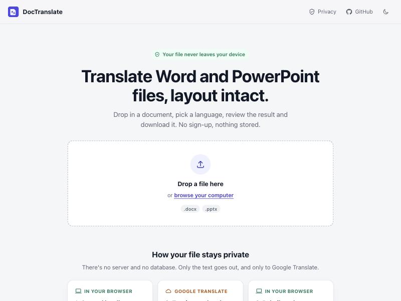
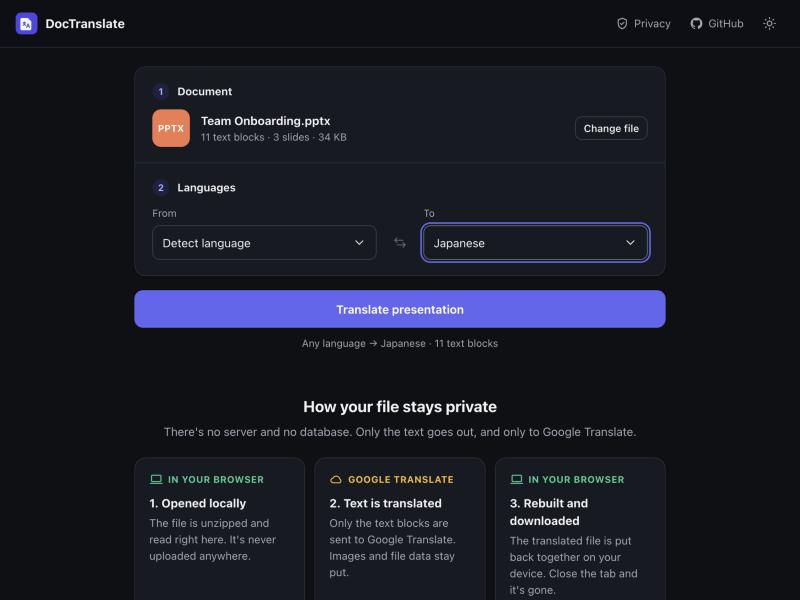
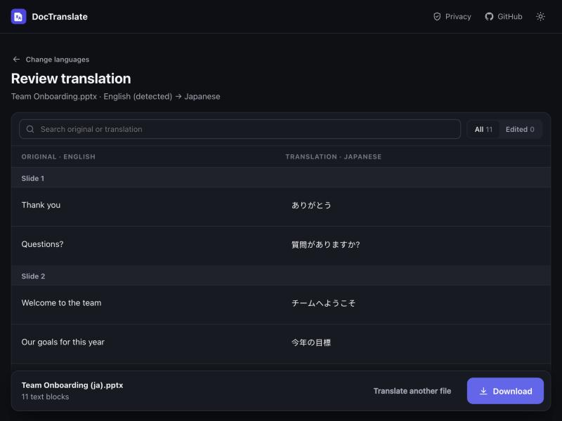

# DocTranslate

**Translate Word and PowerPoint files in your browser, with the layout intact and nothing uploaded.**

DocTranslate started as a small desktop tool I built during my internship. This repo shows how it grew into a privacy-first web app: same core idea, rethought for anyone with a browser.

**[Try it →](https://your-username.github.io/doctranslate/)** <!-- update after deploying -->



| Choose languages | Review and edit before downloading |
|---|---|
|  |  |

---

## The journey

### v1: an internal tool (internship)

The team regularly needed Word documents and slide decks in other languages. The workflow was to copy text into Google Translate one paragraph at a time and paste it back, which was slow and broke formatting. I built a Python + Tkinter app that did it in one go, and shipped it to colleagues as a single `.exe`.

It worked, but looking back as a designer:

- **The UI made people do the computer's job.** You picked "DOCX or PPTX" from a dropdown *before* choosing the file, though the file name already says which.
- **A 100-item language list with no search**, formatted as `Chinese (Simplified) (zh-cn)`.
- **Errors arrived after the fact** in modal pop-ups ("Please choose a file.").
- **No feedback**: a bare progress bar, no count, no way to cancel.
- **Hidden bugs**:
  - The source language was hard-coded to English.
  - Formatting was wiped from every translated paragraph.
  - Each run overwrote the previous output file.
  - The OCR option translated image text and then threw it away.

Source: [`legacy/translation_tool_original.py`](legacy/translation_tool_original.py)

### v2: redesigning the desktop app

First I redesigned it in place ([`desktop/`](desktop)):
- **Interface:** a three-step layout, drag and drop, a searchable language picker, inline validation, a progress panel with cancel, and success/error states that offer next actions.
- **Engine fixes:** keeps formatting, detects the source language, never overwrites output, and is thread-safe.

That fixed the experience, but not the reach: it still needed Python or a 124 MB Windows `.exe`, so only people I could hand a file to could use it.

### v3: the web app (this version)

To make it usable by anyone I moved it to the web. That raised the obvious question: **would you upload a confidential document to a stranger's website?**

So the core design constraint became: **no server, no database, no uploads.**

```
┌──────────── your browser ─────────────┐        ┌──────────────────┐
│ 1. unzip .docx/.pptx, read text runs  │──text─▶│ Google Translate │
│ 3. write translations back, re-zip    │◀─text──│                  │
│ 4. download                           │        └──────────────────┘
└───────────────────────────────────────┘
```

- The file is opened with JSZip **in the browser** and never leaves the device.
- Only text segments go to Google Translate, the same service v1 used. I checked in the browser's network log: translating a whole presentation makes one request, to Google only.
- The page is static and hosted on GitHub Pages. There's nothing to store files in, even by accident.

The app says this upfront ("Your file never leaves your device") and explains it in a 3-step diagram on the page, with an honest note that the text *does* go to Google.

#### New in the web version: a review step

Machine translation gets things wrong. In testing, Google translated *"Second line after a **break**"* into Japanese as a *rest* break. v1 gave you no chance to catch that before the file was saved.

v3 adds a **review screen** before download:
- Original and translation side by side, grouped by slide or section (Slide 3, Notes · Slide 3, Header…).
- Every translation is editable. Edits show an "Edited" badge with Undo.
- Repeated text ("Appears 3×") is edited once and applied everywhere, which keeps terms consistent.
- Search, plus filters for *Edited* and *Not translated*.
- Blocks the service couldn't translate are highlighted rather than failing silently.

### What changed, at a glance

| | v1 (internship) | v3 (web) |
|---|---|---|
| Access | Windows `.exe`, 124 MB | Any browser, ~110 KB gzipped |
| Privacy | Local, but undocumented | File never leaves the device; the data flow is shown in the UI |
| Choosing a file | Pick type from dropdown, then file | Drag and drop or browse, type detected |
| Languages | Unsearchable list, source fixed to English | Searchable picker, suggested languages, auto-detect, swap |
| Validation | Error pop-ups after clicking | Button disabled with an inline hint |
| Progress | Bare bar | "Translating into Japanese… 29 of 48", cancel |
| Quality control | None | Review and edit every segment before download |
| Formatting | Reset to defaults | Kept (font, size, bold, colour) |
| Coverage | Body text, tables, simple groups | + headers, footers, footnotes, nested groups, speaker notes, charts, SmartArt |
| Requests | 2 per paragraph | Batched: a typical deck is 1–3 requests |
| Output | `translated_ja.docx`, overwritten every time | `Original name (ja).docx` |

### What I cut, and why

- **OCR for text inside images.** In v1 it read image text and dropped the result. A browser OCR library would add several megabytes of downloads for every visitor, and the translated text still couldn't go back into the image. I chose a fast first load over a feature that couldn't deliver its promise.
- **Accounts and history.** Saving history would need a database, which goes against the privacy constraint.

---

## How formatting is preserved

`.docx` and `.pptx` files are zip archives of XML. Text lives in *runs* (`<w:r>` in Word, `<a:r>` in PowerPoint) inside paragraphs. A single sentence is often split across runs, e.g. one run per bold word.

Translating run by run produces broken sentences, and replacing whole paragraphs (what v1 did) wipes the styling. So DocTranslate:
1. Joins a paragraph's runs into one segment, splitting at line breaks and tabs.
2. Translates the segment.
3. Writes the result into the **first run**, which keeps its font, size, bold and colour, and empties the rest.

Slides are read in presentation order (from `presentation.xml`, not file names). Merged table cells and repeated text are translated once.

Code: [`web/src/engine/ooxml.ts`](web/src/engine/ooxml.ts) and [`web/src/engine/translate.ts`](web/src/engine/translate.ts).

## Tech

- **React 19 + TypeScript + Vite.** No UI library; the design tokens and components are hand-built.
- **JSZip** for reading and writing Office files in the browser.
- **Vitest** tests covering extraction, round-tripping, batching fallback and offline handling.
- Light and dark themes, responsive down to 375 px.
- Accessibility: keyboard-operable ARIA language picker, labelled controls, live progress updates, visible focus states, reduced-motion support.

## Running locally

```bash
cd web
npm install
npm run dev     # http://localhost:5173
npm test
npm run build
```

## Deploying

Pushing to `main` builds and deploys to GitHub Pages via [`.github/workflows/deploy.yml`](.github/workflows/deploy.yml). In the repo settings, set **Pages → Source** to **GitHub Actions**.

## Limitations

- Translation uses Google Translate's free public endpoint (the same one the `googletrans` Python library uses). It's unofficial and may rate-limit very large documents; blocks that fail are kept in the original language and flagged for review.
- When one paragraph mixes styles (e.g. a single bold word), the translated sentence takes the style of its first run, because word order changes between languages.
- Right-to-left languages are translated, but the document's text direction isn't switched.

## Repo layout

```
web/        the web app (current)
desktop/    v2 desktop redesign (Python + CustomTkinter)
legacy/     v1 as shipped during the internship
samples/    test documents
```
